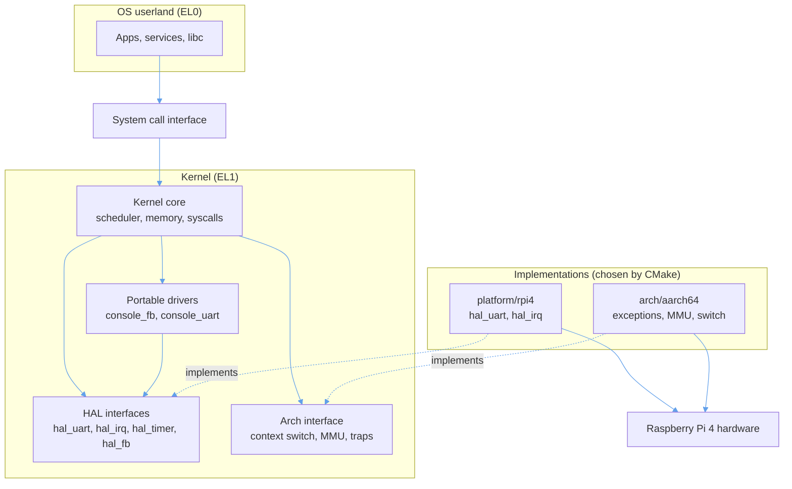

# AmeOS
An Operating System for the Raspberry Pi 4 (for now!), built completely from scratch.

## Overview

AmeOS is designed with a modular architecture to support future porting to different platforms and architectures. The project separates hardware-agnostic logic from hardware-specific implementations. The current primary platform is the Raspberry Pi 4 (`rpi4`).

The codebase is organized as follows:
* `cmake/`: Contains toolchain files for cross-compiling (currently `aarch64`).
* `include/`: Defines public contracts and APIs. 
  * `hal/`: Hardware Abstraction Layer interfaces (UART, timers, IRQ) implemented by the platform layer.
  * `arch/`: Architecture-specific interfaces (context switching, MMU) implemented by the architecture layer.
  * `kernel/`: Internal APIs such as memory allocation (later), scheduling (later), and standard library functions.
  * `drivers/`: Kernel drivers such as the console
  * `gfx/`: Graphics-related files such as the font header 
  * `lib/`: Kernel libraries such as String
* `src/`: Contains all implementation code.
  * `kernel/`: Platform-independent core components (scheduler, memory management, system calls).
  * `drivers/`: Portable device drivers built on top of the HAL.
  * `gfx/`: Graphics-related implementations
  * `lib/`: Kernel libraries such as String 
  * `arch/aarch64/`: CPU-specific code for ARM64, including boot stubs, exception vectors, and traps.
  * `platform/rpi4/`: Board-specific implementations mapping HAL definitions to the BCM2711 SoC.

## Working Features
* **Mini UART**
* **GIC-400 interrupts**
* **ARM Generic Timer**
* **Graphical console**
* **Basic shell**: `help`, `echo`, `version`, `clear`, `uptime`, `peek`, `reboot`, `shutdown`

## Documentation
In the [GitHub Pages](https://amerody.github.io/AmeOS/).

## Build Instructions
AmeOS uses CMake presets and Ninja to cross-compile for bare-metal AArch64. The same commands work on Windows and Linux (macOS is untested), from a terminal or from VS Code.

### Prerequisites
* **CMake** 3.25 or newer and **Ninja** (the default generator).
* **LLVM 19 or newer**: `clang`, `clang++`, `lld` and `llvm-objcopy`. If LLVM isn't on your `PATH` (or in `C:\Program Files\LLVM` on Windows), set the `LLVM_ROOT` environment variable to its install directory.
* **QEMU 9.0 or newer** (`qemu-system-aarch64`) with the `raspi4b` machine, to run the kernel without a Pi. On Windows it's also found in `C:\Program Files\qemu`.
* **An AArch64 GDB** (`aarch64-none-elf-gdb` or `gdb-multiarch`), for debugging. Optional.
* **Doxygen**, to generate the documentation. Optional.

### Building
1. **Configure** with a preset (`rpi4-debug` or `rpi4-release`):
   ```bash
   cmake --preset rpi4-debug
   ```
2. **Build**:
   ```bash
   cmake --build --preset rpi4-debug
   ```
   This produces `build/rpi4-debug/kernel.elf` (with symbols, for GDB) and `kernel8.img` (the raw image that QEMU and the Pi boot). If Doxygen is installed, the documentation is generated into `docs/html/` too. To skip it, configure with `-DKERNEL_BUILD_DOCS=OFF`.

### Running in QEMU
```bash
cmake --build --preset rpi4-debug --target run     # build and boot: QEMU window (framebuffer) + UART shell in the terminal
cmake --build --preset rpi4-debug --target debug   # same, but wait for GDB on localhost:1234
```
Quit QEMU with Ctrl-A X in the terminal, or by closing its window.

In a bash shell (Linux, macOS, WSL, Git Bash), `tools/run.sh` does the same and adds a headless mode that stops after a timeout, which is handy for quick test runs. `tools/run.sh -h` lists the options.

### Visual Studio Code
The repository includes task and debug configurations for VS Code with the CMake Tools extension.
* **Build**: the `build-kernel` task builds the active CMake preset.
* **Debug**: start **"Attach to QEMU (AArch64)"** in the Run & Debug pane. Its pre-launch task `qemu-debug` boots QEMU in the background, halted until GDB connects on `localhost:1234`.
* **GDB**: the launch configuration expects `aarch64-none-elf-gdb` on your `PATH`.

## Architecture


## AI Use

The kernel code is written by hand; Claude Code is used as a tutor, reviewer and documentation writer. Details: [docs/ai-use.md](docs/ai-use.md).

## References
The hardware manuals, specifications and other sources used for AmeOS are listed in [docs/references.md](docs/references.md).

## Contributing
Refer to [CONTRIBUTING.md](https://github.com/Amerody/AmeOS/blob/main/CONTRIBUTING.md)

## License
AmeOS is free software, licensed under the [GNU General Public License v3.0 or later](https://github.com/Amerody/AmeOS/blob/main/LICENSE).
 
You can use, study, modify, and share it freely. If you distribute AmeOS or a modified version of it, you must release the source under the same license. Whatever is built from this project stays open for everyone to learn from.

The device tree blob src/platform/rpi4/bcm2711-rpi-4-b.dtb is taken unmodified from the Raspberry Pi firmware repository (commit f2491b7). It is built from the device tree sources in the Raspberry Pi Linux kernel and licensed under the GNU GPL v2 (see [src/platform/rpi4/COPYING.linux](https://github.com/Amerody/AmeOS/blob/main/src/platform/rpi4/COPYING.linux)). It is a separate file loaded at boot, not part of the AmeOS kernel image, and is not covered by AmeOS's license.

The console font is [Terminus Font](https://terminus-font.sourceforge.net/) by Dimitar Toshkov Zhekov, licensed under the SIL Open Font License 1.1. The original BDF files and the license text are in `terminus/`; the generated `include/gfx/*.inc` files are covered by the same license.

Copyright (C) 2026 Amerody
