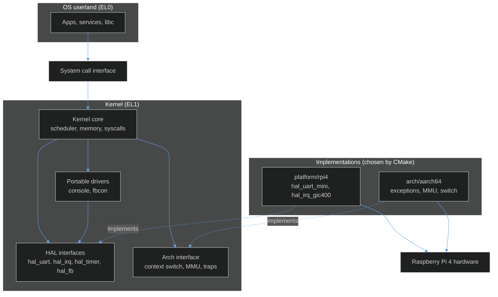

# AmeOS
An Operating System for the Raspberry Pi 4 (for now!), built completely from scratch.

## Overview

AmeOS is designed with a modular architecture to support future porting to different platforms and architectures. The project separates hardware-agnostic logic from hardware-specific implementations. The current primary platform is the Raspberry Pi 4 (`rpi4`).

The codebase is organized as follows:
* `cmake/`: Contains toolchain files for cross-compiling (currently `aarch64`).
* `include/`: Defines public contracts and APIs. 
  * `hal/`: Hardware Abstraction Layer interfaces (UART, timers, IRQ) implemented by the platform layer.
  * `arch/`: Architecture-specific interfaces (context switching, MMU) implemented by the architecture layer.
  * `kernel/`: Internal APIs such as memory allocation, scheduling, and standard library functions.
  * `drivers/`: Kernel drivers such as the console
  * `gfx/`: Graphics-related files such as the font header and the font defining
* `src/`: Contains all implementation code.
  * `kernel/`: Platform-independent core components (scheduler, memory management, system calls).
  * `drivers/`: Portable device drivers built on top of the HAL.
  * `gfx/`: Graphics-related implementations
  * `lib/`: Kernel libraries such as String 
  * `arch/aarch64/`: CPU-specific code for ARM64, including boot stubs, exception vectors, and traps.
  * `platform/rpi4/`: Board-specific implementations mapping HAL definitions to the BCM2711 SoC.

## Build Instructions
AmeOS uses CMake and Ninja to manage cross-compilation. You can build the kernel via the command line or directly through Visual Studio Code.

### Prerequisites
* **CMake**: Version 3.25 or newer.
* **Ninja**: Ninja is configured as the default generator.
* **LLVM/Clang**: Clang and Clang++ for bare-metal AArch64 cross-compilation.
* **LLVM tools**: `llvm-objcopy` is required to extract the raw `kernel8.img` binary.
* **Debugger**: An AArch64-capable GDB (e.g., `aarch64-none-elf-gdb` or `gdb-multiarch`).
* **QEMU**: QEMU 9.0 or newer (`qemu-system-aarch64`), requiring support for the `raspi4b` machine type. Only needed if you are going to use QEMU to test the build
* **Documentation (Optional)**: Doxygen for generating HTML documentation.

### Command Line Build
AmeOS uses CMake Presets to handle target platforms and build types.
The same presets and commands work on both Windows and Linux. Mac is not tested.

1. **Configure the project** using a preset matching your host and desired build type:
   ```bash
   cmake --preset rpi4-debug
   ```
   *Available presets include: `rpi4-debug`, `rpi4-release`.*

2. **Build the kernel**:
   ```bash
   cmake --build --preset rpi4-debug
   ```
   *This compiles the `kernel.elf` file and automatically invokes `llvm-objcopy` to generate `kernel8.img`. If Doxygen is installed, documentation is also generated by default during the build.*

3. **Run or Debug with QEMU**:
   * Boot the kernel in QEMU: `cmake --build --preset rpi4-debug --target run`
   * Boot and wait for GDB to attach on port 1234: `cmake --build --preset rpi4-debug --target debug`

### Visual Studio Code Integration
The repository includes integrated debugging and task configurations for VS Code.

* **Building**: The `tasks.json` provides a `build-kernel` task that automatically builds the project using your active CMake preset.
* **Debugging**: Select the **"Attach to QEMU (AArch64)"** configuration in the Run & Debug pane. Launching this will automatically run the `qemu-debug` pre-launch task. <br>This task boots QEMU in the background (`-M raspi4b`) and halts execution until the debugger connects over `localhost:1234`.
* **GDB Path**: By default, the launch configuration looks for `aarch64-none-elf-gdb` in your system `PATH`.

## Architecture


## AI Use

AmeOS is primarily a learning project: the goal is to understand OS internals by building one. The kernel code is written by hand. AI tools, mainly [Claude Code](https://docs.claude.com/en/docs/claude-code/overview) by Anthropic, act as a tutor, reviewer and documentation writer rather than as the author of the kernel.

### How AI is used
* **Explaining concepts**: Working through how things like exception levels, interrupt controllers, and memory management work, before writing the code for them.
* **Pointing to documentation**: Hardware and architecture details are looked up in the primary sources (the BCM2711 ARM Peripherals document, the Arm Architecture Reference Manual, and the GIC-400/GICv2 specifications). The AI is asked to cite which section or register to read instead of supplying values directly.
* **Code review**: Reviewing changes for bugs such as missing `volatile` qualifiers or barriers on MMIO accesses, wrong register offsets, alignment problems, incorrect exception-level assumptions, and kernel code that bypasses the HAL.
* **Design discussion**: Deciding where new code belongs within the layered architecture (kernel core, drivers, HAL, platform, and architecture code).
* **Debugging**: Helping interpret QEMU output, exception information, and GDB sessions.
* **Documentation**: Written partly by Claude Code and partly by me. All of it is reviewed by hand.
* **Decision records**: Architecture decision records in `docs/internal/decisions/` are written by Claude Code from an interview with me. The decisions, alternatives, and reasoning are mine; the AI asks the questions and writes up the answers.

### Authorship
* **Kernel code**: All kernel code, including drivers, the HAL, and libraries, is written by me. AI may suggest small fixes during review, but the code is typed and understood by hand.
* **Tooling**: `tools/run.sh` (QEMU test runner) and `tools/bdf2inc.py` (font conversion) were written by Claude Code.
* **Documentation**: Written by both Claude Code and me, and of course reviewed by me. This includes both `.md` files and doxygen comments in the source.

### How correctness is checked
* Changes are built and run in QEMU (`raspi4b`) using `tools/run.sh` or using the VSCode task `qemu-debug` before being committed.
* Register addresses, offsets, and bit fields are verified against the official documentation, not taken from the AI's answers.
* Real-hardware testing on a Raspberry Pi 4 is planned. Until then, behavior that QEMU does not emulate accurately is untested.

### AI configuration in this repository
* `CLAUDE.md`: Project context and rules for Claude Code, including the instruction to explain and review rather than write kernel code.
* `.claude/skills/decision/`: A skill that interviews me and writes a decision record.
* `.claude/skills/document/`: A skill that writes Doxygen comments across the code base and reports to me the added comments for review.
* `.claude/skills/bug-hunt/`: A skill that checks the whole code base, or a given directory, for possible bugs, writes the corresponding `@bug` and reports back to me.
* `.claude/skills/kernel-review/`: A skill that checks the given directories or uncommitted changes for issues and reports them.
* `.claude/agents/concurrency-reviewer.md`: An agent that checks the given code for concurrency and memory-ordering bugs.
* `docs/internal/style.md`: The coding style guide.

## Contributing
AmeOS is a personal learning project. Writing every part of it myself is the whole point, so **I'm not accepting pull requests**, and any that are opened will be closed.
Refer to [CONTRIBUTING.md](CONTRIBUTING.md)


## License
AmeOS is free software, licensed under the [GNU General Public License v3.0 or later](LICENSE).
 
You can use, study, modify, and share it freely. If you distribute AmeOS or a modified version of it, you must release the source under the same license. Whatever is built from this project stays open for everyone to learn from.

The device tree blob src/platform/rpi4/bcm2711-rpi-4-b.dtb is taken unmodified from the Raspberry Pi firmware repository (commit f2491b7). It is built from the device tree sources in the Raspberry Pi Linux kernel and licensed under the GNU GPL v2 (see src/platform/rpi4/COPYING.linux). It is a separate file loaded at boot, not part of the AmeOS kernel image, and is not covered by AmeOS's license.

The console font is [Terminus Font](https://terminus-font.sourceforge.net/) by Dimitar Toshkov Zhekov, licensed under the SIL Open Font License 1.1. The original BDF files and the license text are in `terminus/`; the generated `include/gfx/*.inc` files are covered by the same license.

Copyright (C) 2026 Amerody
