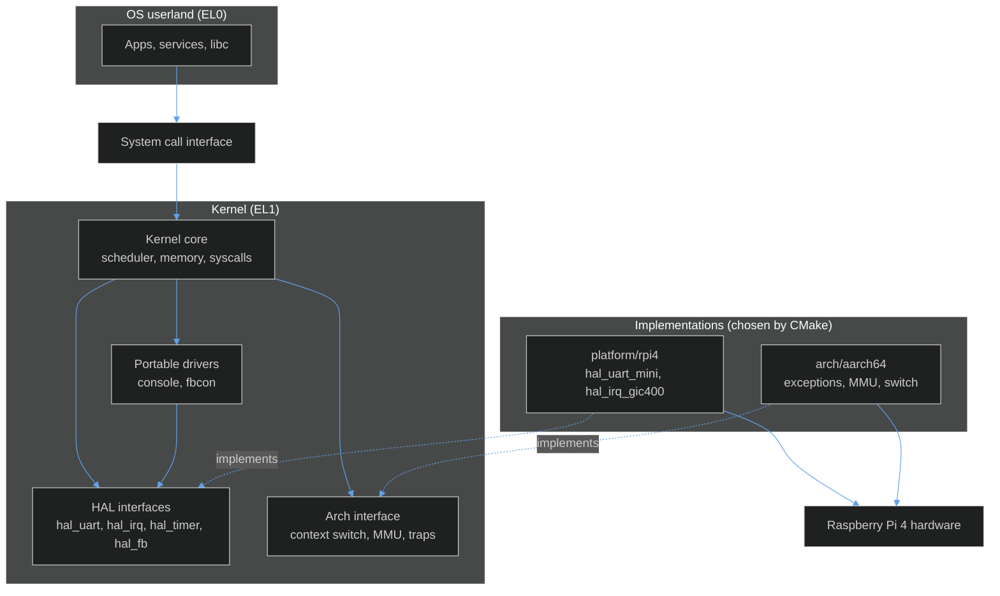

# AmeOS
An Operating System for the Raspberry Pi 4 (for now!), built completely from scratch.

## Overview

AmeOS is designed with a modular architecture to support future porting to different platforms and architectures. The project separates hardware-agnostic logic from hardware-specific implementations. The current primary platform is the Raspberry Pi 4 (`rpi4`).

The codebase is organized as follows:
* **`cmake/`**: Contains toolchain files for cross-compiling (currently `aarch64`).
* **`include/`**: Defines public contracts and APIs. 
  * **`hal/`**: Hardware Abstraction Layer interfaces (UART, timers, IRQ) implemented by the platform layer.
  * **`arch/`**: Architecture-specific interfaces (context switching, MMU) implemented by the architecture layer.
  * **`kernel/`**: Internal APIs such as memory allocation, scheduling, and standard library functions.
  * **`drivers/`**: Kernel drivers such as the console
  * **`gfx`**: Graphics-related files such as the font header and the font defining
* **`src/`**: Contains all implementation code.
  * **`kernel/`**: Platform-independent core components (scheduler, memory management, system calls).
  * **`drivers/`**: Portable device drivers built on top of the HAL.
  * **`gfx/`**: Graphics-related implementations
  * **`lib`**: Kernel libraries such as String 
  * **`arch/aarch64/`**: CPU-specific code for ARM64, including boot stubs, exception vectors, and traps.
  * **`platform/rpi4/`**: Board-specific implementations mapping HAL definitions to the BCM2711 SoC.

## Build Instructions
AmeOS uses CMake and Ninja to manage cross-compilation. You can build the kernel via the command line or directly through Visual Studio Code.

### Prerequisites
* **CMake**: Version 3.25 or newer.
* **Ninja**: Ninja is configured as the default generator.
* **LLVM/Clang**: Clang and Clang++ for bare-metal AArch64 cross-compilation.
* **LLVM tools**: `llvm-objcopy` is required to extract the raw `kernel8.img` binary.
* **Debugger**: An AArch64-capable GDB (e.g., `aarch64-none-elf-gdb` or `gdb-multiarch`).
* **QEMU**: QEMU 9.0 or newer (`qemu-system-aarch64`), requiring support for the `raspi4b` machine type. Only needed if you are going to use QEMU to test the build
* **Documentation (Optional)**: Doxygen for generating HTML documentation.

### Command Line Build
AmeOS uses CMake Presets to handle target platforms and build types.
The same presets and commands work on both Windows and Linux. Mac is not tested.

1. **Configure the project** using a preset matching your host and desired build type:
   ```bash
   cmake --preset rpi4-debug
   ```
   *Available presets include: `rpi4-debug`, `rpi4-release`.*

2. **Build the kernel**:
   ```bash
   cmake --build --preset rpi4-debug
   ```
   *This compiles the `kernel.elf` file and automatically invokes `llvm-objcopy` to generate `kernel8.img`. If Doxygen is installed, documentation is also generated by default during the build.*

3. **Run or Debug with QEMU**:
   * Boot the kernel in QEMU: `cmake --build --preset rpi4-debug --target run`
   * Boot and wait for GDB to attach on port 1234: `cmake --build --preset rpi4-debug --target debug`

### Visual Studio Code Integration
The repository includes integrated debugging and task configurations for VS Code.

* **Building**: The `tasks.json` provides a `build-kernel` task that automatically builds the project using your active CMake preset.
* **Debugging**: Select the **"Attach to QEMU (AArch64)"** configuration in the Run & Debug pane. Launching this will automatically run the `qemu-debug` pre-launch task. <br>This task boots QEMU in the background (`-M raspi4b`) and halts execution until the debugger connects over `localhost:1234`.
* **GDB Path**: By default, the launch configuration looks for `aarch64-none-elf-gdb` in your system `PATH`.

## Architecture

